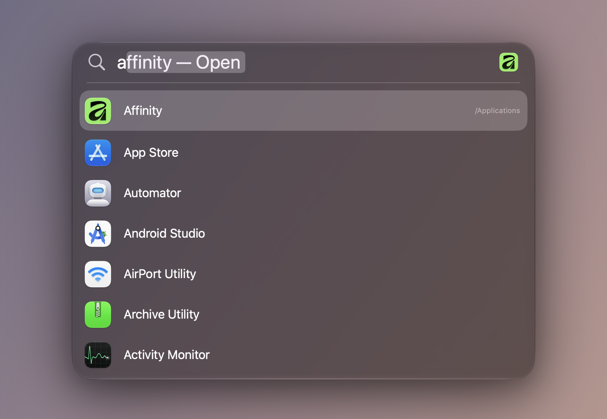

# Spotlite

A lightweight app launcher for macOS 26. Press a shortcut, type a few letters,
press Return.

Spotlight searches everything on your Mac. It is slow to settle and noisy when
you only want to open an app. Spotlite looks like Spotlight but does only the
launcher part, and it stays out of the way until you call it. It uses 0% CPU
while idle and ranks results in about 6 microseconds per keystroke.



## Features

- Fuzzy app search: `saf` finds Safari, and `gc` finds Google Chrome.
- Apps you launch often rank higher, but not for queries they match poorly.
- A calculator that shows the result as you type. Return copies it.
- Integer base conversion and offline unit conversion.
- System Settings panes by name: `blue` opens Bluetooth.
- System commands such as Lock Screen, Sleep, Restart and Empty Trash.
- Links to folders, files or web pages, each with its own name and alias.
- Links with a `{query}` placeholder. Press Tab and type to search GitHub or to pass text to a Shortcut.
- A web search row (DuckDuckGo, Google or Bing). Show it always, only when no local result matches, or never.
- Aliases, so `ps` opens Photoshop.
- A choice of which folders to search for apps.
- Command-Delete hides apps that you never launch.
- An optional list of frequently used apps before you type, and a dot under apps that are running.
- Plugins: add your own commands with a small script in any language. See [plugins/README.md](plugins/README.md). Caffeinate and UUID generation are available as plugins from the gallery.
- The look of macOS 26 Spotlight, Liquid Glass included, in light and dark mode.

## Install

With Homebrew:

```sh
brew install ivalkenburg/tap/spotlite
xattr -dr com.apple.quarantine /Applications/Spotlite.app
```

Apple has not notarized Spotlite, so macOS blocks its first launch. The `xattr`
line allows it. You can also open the app once and click "Open Anyway" in
System Settings › Privacy & Security.

### Build from source

You need macOS 26 and Xcode 26.

```sh
git clone https://github.com/ivalkenburg/spotlite.git
cd spotlite
make install
```

This builds the app and copies it to `/Applications`. "Start at login" works
only from there.

## Usage

| Key | Action |
| --- | --- |
| `Option-Space` | Show or hide the launcher (configurable) |
| `Up` / `Down` | Move the selection |
| `Return` | Open the selected result, or copy a calculator result |
| `Tab` | Enter a plugin command's list, or type input for the selected `{query}` link |
| `Backspace` on an empty query, `Shift-Tab` | Go back from a list that a command opened |
| `Command-1` to `Command-9` | Open the nth result |
| `Command-Return` | Reveal the selected app or file in Finder |
| `Option-Return` | Copy the selected app's path or link's address |
| `Command-K` | Open the action list of the selected plugin result |
| `Command-Q` | Quit the selected app if it is running |
| `Command-Delete` | Hide the selected app from results |
| `Command-Z` | Undo hiding an app, before you edit the query or close the panel |
| `Escape` | Close |

Open Settings from the menu bar icon, or search for `settings` in Spotlite. Drag the
edges of the panel to resize it. Drag an empty part of the search bar to move it up or
down. Spotlite respects the macOS Reduce Motion setting and skips panel scaling and
animated resizing.

### Search

Choose web search visibility and app name completion in Settings → Search. New
installations show web search only when no local result matches. Upgrades keep the
previous web search setting. Calculations and conversions never show a web search row.

### Messages

Spotlite confirms result copies, plugin actions, and hiding or restoring items with
a short translucent message. Messages appear at the bottom center of the screen by
default. Choose another position in Settings → Appearance → Message position. To hide
routine confirmations, turn off Show confirmation messages on the same page. Failures
and position previews still appear.

## Plugins

A plugin adds commands to search. It is a folder with a `plugin.json` and, usually, one
script. Spotlite starts the script only when you use one of its commands, and the plugin
costs nothing while idle. Install plugins in Settings → Plugins, from a folder, an
address or the built-in gallery.

[plugins/README.md](plugins/README.md) is the guide for writing, installing and sharing
plugins. Example plugins are in [`plugins`](plugins).

A plugin runs with your permissions. Install only plugins that you trust.

## Permissions

Searching and launching need no permissions, not even Accessibility. Restart, Shut Down,
Log Out, Empty Trash and Toggle Dark Mode send Apple events to loginwindow, Finder or
System Events. macOS asks you once per app to allow this under Privacy & Security ›
Automation.

## Development

```sh
make          # build and sign build/Spotlite.app
make run      # build, quit the running copy, open
make test     # swift test
make install  # copy to /Applications
```

`make` builds a release app by default. Use `make debug` for a debug app,
`make run CONFIG=debug` to run it, and `make install CONFIG=debug` to install it.
[AGENTS.md](AGENTS.md) describes the code layout, the performance rules and the
`--bench` and `--search` tools.

The `SPOTLITE_DEV_*` hooks exist only in debug builds. Most of them run a check and
exit, and AGENTS.md lists them. For example, this one checks toast layout, replacement,
dismissal and the placement control:

```sh
make debug
SPOTLITE_DEV_TOAST=1 build/Spotlite.app/Contents/MacOS/Spotlite
```

Set `SPOTLITE_DEV_CAPTURE_DIR=/tmp/spotlite-captures` with the Toast, Utilities or Plugins
hook to save native screenshots next to the frame checks. Capturing needs existing
Screen Recording access. The hooks do not request it.

To check plugin query replacement, response copies and layout on short displays offline:

```sh
make debug
SPOTLITE_DEV_REGRESSIONS=1 SPOTLITE_DEV_PIN=1 \
  SPOTLITE_DEV_PLUGINS_DIR="$PWD/Tests/Fixtures/Plugins" \
  build/Spotlite.app/Contents/MacOS/Spotlite
```

This check preserves the clipboard and the saved preferences.

To check plugin configuration forms, setup routing, validation, Save, Cancel, Reset and
per-run snapshots, use an isolated settings folder:

```sh
make debug
SPOTLITE_DEV_CONFIGURATION=1 SPOTLITE_DEV_PIN=1 \
  SPOTLITE_DEV_PLUGINS_DIR="$PWD/Tests/Fixtures/Plugins" \
  SPOTLITE_DEV_PLUGIN_SETTINGS_DIR="$(mktemp -d)" \
  build/Spotlite.app/Contents/MacOS/Spotlite
```

With existing Screen Recording access, this check writes native captures of the forms
to `build/configuration-checks`.

## License

MIT. See [LICENSE](LICENSE).
