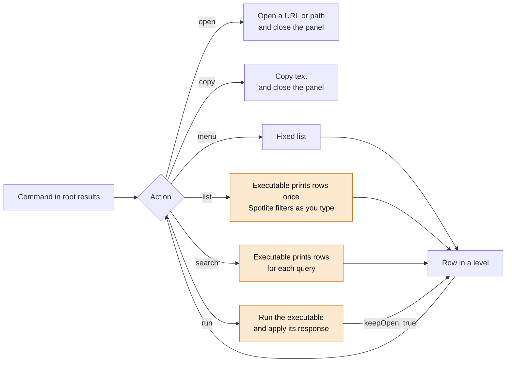

# Spotlite plugins

A plugin adds commands to Spotlite's search. It is a folder with a `plugin.json` and, in
most cases, one executable written in any language. This guide covers how plugins work,
how to write one, and how users install and share them.

Spotlite starts the executable only when someone uses one of the plugin's commands. The
executable prints JSON to standard output, and Spotlite shows the result. Between uses a
plugin costs its manifest in memory. It has no process, timer or folder watcher.

A plugin runs with the permissions of your user. Install only plugins you trust.

Working examples are in this folder:

| Plugin | Shows |
| --- | --- |
| [`kubectx`](kubectx) | A `list` of kubectl contexts and a `run` action that switches one |
| [`github`](github) | A `search` with settings, a secret, row accessories and extra row actions |
| [`caffeinate`](caffeinate) | Durations in a `list` with `sort: false`, a background process, and an `update` tied to it that shows in the menu bar |
| [`findfiles`](findfiles) | A streamed `search` |
| [`uuid`](uuid) | A fixed `menu` in the manifest whose rows `run` the script and `copy` its answer |

## Quick start

This plugin greets the name you type. You need an editor and `jq`, which macOS includes.

1. Make a folder, for example `~/Code/hello`.
2. Save this as `plugin.json` in the folder:

   ```json
   {
     "$schema": "https://raw.githubusercontent.com/ivalkenburg/spotlite/main/plugins/plugin.schema.json",
     "id": "hello",
     "name": "Hello",
     "version": "1.0.0",
     "executable": "hello.sh",
     "commands": [
       {
         "id": "greet",
         "title": "Greet Someone",
         "keyword": "hello",
         "icon": "hand.wave",
         "action": { "type": "search", "emptyText": "Type a name" }
       }
     ]
   }
   ```

3. Save this as `hello.sh` and make it executable with `chmod +x hello.sh`:

   ```sh
   #!/bin/sh
   # The query is the last argument of a search.
   jq -n --arg name "$1" '{
     items: [{
       title: ("Hello, " + $name),
       subtitle: "Return copies the greeting",
       action: {type: "copy", text: ("Hello, " + $name)}
     }]
   }'
   ```

4. Link the folder into Spotlite's plugin folder:

   ```sh
   ln -s ~/Code/hello ~/Library/Application\ Support/Spotlite/Plugins/hello
   ```

5. In Settings → Plugins, choose ⋯ → Reload Plugins.
6. Open Spotlite and type `hello`. Press Tab or Return on Greet Someone, then type a name.

Spotlite runs `hello.sh` once the typing pauses, and shows the row it prints. Return copies
the greeting.

While you develop, keep the folder linked. Spotlite starts the executable fresh on every
use, so an edit to the script applies at once. After you edit `plugin.json`, choose
⋯ → Reload Plugins. To see what the script printed, and why Spotlite rejected it, use
Run Command… (see [Debugging](#debugging)).

## How a plugin works

A plugin has commands. A command is a result in the root search. It ranks, hides, takes an
alias and learns launch history like an app. When the user picks a command, Spotlite does
its action. An action either finishes (it opens, copies or runs something) or enters a
level: a list of rows. Each row has an action of its own.



The shaded actions start the executable. `open`, `copy` and `menu` are answered inside
Spotlite and start nothing.

The executable has no state in Spotlite. Each run is a new process that receives its
arguments and environment, prints a response and exits. A plugin that needs memory between
runs keeps it in its own data folder (`SPOTLITE_PLUGIN_DATA`).

A plugin whose actions are all `open`, `copy` or `menu` needs no executable.

## Manifest

`plugin.json` sits at the top of the plugin's folder.

```json
{
  "$schema": "https://raw.githubusercontent.com/ivalkenburg/spotlite/main/plugins/plugin.schema.json",
  "id": "kubectx",
  "name": "Kube Context",
  "version": "1.0.0",
  "description": "Switch the current kubectl context.",
  "author": "you",
  "executable": "kubectx.sh",
  "timeout": 10,
  "commands": [
    {
      "id": "switch",
      "title": "Switch Kube Context",
      "keyword": "kubectx",
      "subtitle": "kubectl",
      "icon": "shippingbox",
      "action": { "type": "list" }
    }
  ]
}
```

| Key | Meaning |
| --- | --- |
| `id`, `name`, `commands` | Required. Ids use letters, digits, `.`, `-` and `_`, up to 128 characters. A plugin id cannot start with `.`. Plugin ids must be unique when letter case is ignored. Command ids are unique within the plugin. |
| `version`, `description`, `author` | Optional text. Settings and the install sheet show it. Check for Updates compares `version`. |
| `executable` | The path of the program inside the plugin's folder. It must have the executable bit. Leave it out when every action is `open`, `copy` or `menu`. |
| `timeout` | The seconds a run may take, 1 to 60. Default 10. |
| `settings` | Optional configuration fields, shared by all commands of the plugin. See [Settings](#settings). |
| `$schema` | Optional. Spotlite ignores it. See below. |

A command has these keys:

| Key | Meaning |
| --- | --- |
| `id`, `title`, `action` | Required. |
| `keyword` | A name that finds the command when its title lacks it. It applies until the user sets an alias in Settings → Items. |
| `subtitle`, `icon` | Optional. See [icons](#icons). |
| `actions` | More actions for the command. See [Other actions](#other-actions). |

`plugin.json` must fit within 256 KB. A plugin with a missing or invalid manifest, an
executable outside its folder, or a repeated id is unusable. Settings shows the reason.

[`plugin.schema.json`](plugin.schema.json) describes the manifest as a JSON Schema. Set
`"$schema"` to its address, as the examples do. An editor such as VS Code then completes
keys, explains each one and marks mistakes. The schema is stricter than Spotlite. It also
marks keys that Spotlite ignores, such as a misspelled one, and values that Spotlite clamps,
such as a `timeout` of 90. [`plugin-response.schema.json`](plugin-response.schema.json)
describes what the executable prints (see [Response](#response)).

## Actions

A command and every row carry one action. It is what Return does.

| Action | Effect | Starts the executable |
| --- | --- | --- |
| `{"type":"open","url":"…"}` | Opens a URL or a file path and closes the panel. | no |
| `{"type":"copy","text":"…"}` | Copies the text and closes the panel. | no |
| `{"type":"menu","items":[…]}` | Enters a fixed list. | no |
| `{"type":"list","args":[…]}` | Enters a list that the executable prints once. Spotlite filters it as you type. | once |
| `{"type":"search","args":[…],"debounce":200,"minQuery":1}` | Enters a list that the executable prints for each query. | per query, after typing pauses |
| `{"type":"run","args":[…],"keepOpen":false}` | Closes the panel at once, runs in the background and applies the response. With `keepOpen`, the panel stays and the list reloads. | once |

A `search` runs when typing has paused for `debounce` milliseconds (0 to 2000, default 200)
and the query has at least `minQuery` characters (default 1). Spotlite trims the query. A
space typed before or after it keeps the rows and does not ask again.

Tab also enters a `menu`, `list` or `search`. Backspace on an empty query, or Shift-Tab,
goes back. ⌥↩ on a row whose action is `open` copies its address, unless the row binds ⌥
itself (see [Other actions](#other-actions)).

`list`, `search` and `menu` also take these keys:

| Key | Meaning |
| --- | --- |
| `emptyText` | Text for a level with no rows. This happens when nothing came back or when typing filtered every row out. A `search` also shows it while the query is shorter than `minQuery`. Default: "No results", and nothing below `minQuery`. Nothing shows while the first answer is still loading. |
| `sort` | `list` and `menu` only. `false` keeps matches in the plugin's order, and typing still narrows the rows. Default `true`, best match first. |
| `stream` | `list` and `search` only. `true` reads one row per line and shows each row as it arrives. See [Streaming](#streaming). Default `false`. |

### Other actions

A command or a row can offer more than Return's action. `actions` lists them. Each has a
`title`, any `action` from above, an optional SF Symbol `icon` and an optional `shortcut`:

```json
{ "title": "octo/app", "action": { "type": "open", "url": "https://github.com/octo/app" },
  "actions": [
    { "title": "Copy Clone URL", "shortcut": "cmd", "icon": "doc.on.doc",
      "action": { "type": "copy", "text": "https://github.com/octo/app.git" } },
    { "title": "Open Issues",
      "action": { "type": "open", "url": "https://github.com/octo/app/issues" } }
  ] }
```

`shortcut` is a modifier held with Return. Use `cmd`, `opt`, `shift` or `ctrl` (also
`command`, `option`, `alt` and `control`), or join several with `+`, such as `cmd+shift`.
While the user holds it, the selected row shows the action's title. Only the exact chord
matches.

The first action to claim a chord gets it, and a later one is listed without it.
An action without a `shortcut` is reached only from the action list. A declared `opt`
replaces the built-in ⌥↩ copy.

⌘K opens the action list of the selected row. It shows Return's action first, then the
others in order, each with its key, then the built-in Copy Link on an `open` row. Typing
filters the list. Return or a click runs an action. Escape, Backspace on an empty query,
Shift-Tab or ⌘K again goes back to the rows, with the query and selection as they were. An
action that enters a level goes back to the row, not to the list.

Spotlite reads at most 16 actions. It skips a malformed action (no title, an unknown action
type or an unknown `shortcut`) and keeps the others. `actions` inside an action are ignored.
A row without an `action` still offers its `actions` in the list.

### Confirmation

Any action can ask before it runs. Put `confirm` beside its `type`, as a question or an
object:

```json
{ "type": "run", "args": ["delete", "main"], "keepOpen": true,
  "confirm": { "title": "Delete branch main?", "message": "It is not merged.",
               "button": "Delete", "destructive": true } }
```

`"confirm": "Delete branch main?"` is the short form. The question takes the place of the
rows inside the panel. The chip asks the question, the first row is the button (default
"Confirm") with the `message` beside it, and the second row is Cancel. Return or a click on
the button runs the action. Escape, Cancel, Backspace or Shift-Tab goes back to the rows. A
Return that the user still holds from the row that asked does not answer the question.
`destructive` marks the button with a warning icon.

A `confirm` that is not a nonempty string, or an object without a `title`, drops the row or
action that carries it, so that nothing runs unasked. On a manifest command it makes the
manifest invalid.

## Running the executable

Spotlite calls the executable as `executable <args…>`. For a `search`, the query is the
last argument. The working directory is the plugin's folder. Standard input is empty.

The environment is Spotlite's own, with these additions:

| Variable | Value |
| --- | --- |
| `SPOTLITE_QUERY` | What the user typed. |
| `SPOTLITE_PLUGIN_DIR` | The plugin's folder. |
| `SPOTLITE_PLUGIN_DATA` | A folder for the plugin's own state. It exists and survives reinstalling. |
| `SPOTLITE_PLUGIN_ID` | The manifest's id. |
| `SPOTLITE_CONFIG` | The effective configuration as a JSON object, with defaults applied. `{}` when no fields are declared. |
| `SPOTLITE_CONFIG_<ID>` | Each set string, number or boolean setting on its own. See below. |
| `SPOTLITE_COMMAND` | The id of the manifest command the user started from. Rows nested inside its list, search or menu get it too. |
| `SPOTLITE_ACTION` | `run`, `list` or `search`: the kind of action that started this run. |
| `SPOTLITE_APPEARANCE` | `light` or `dark`: Spotlite's appearance when the run started. |
| `SPOTLITE_VERSION` | Spotlite's version, such as `1.1.3`. `0.0.0` when it runs outside its app bundle. |
| `SPOTLITE_PID` | Spotlite's process id. `caffeinate -w "$SPOTLITE_PID"` ends when Spotlite quits. |
| `PATH` | Spotlite's, plus `/opt/homebrew/bin`, `/opt/homebrew/sbin` and `/usr/local/bin`. |

`SPOTLITE_CONFIG_<ID>` takes the setting's id in upper case. Every character other than `A`
to `Z` and `0` to `9` becomes `_`, so `resultLimit` is `SPOTLITE_CONFIG_RESULTLIMIT`.
Strings pass as they are, and `file` and `folder` paths are expanded as in
`SPOTLITE_CONFIG`. Numbers pass as written in the form (`20`, `0.5`) and booleans as `true`
or `false`. A value that is unset is not exported. Other kinds of value appear only in
`SPOTLITE_CONFIG`.

If two ids map to the same name (`api-key` and `api_key`), neither is
exported, so a name never depends on the order of the fields. Read `SPOTLITE_CONFIG`
instead. It is authoritative and always has every value.

### Failure, timeout and cancellation

A non-zero exit is a failure. The toast shows the last nonempty line on standard error, so
a traceback or a script under `set -e` leaves the error that stopped it there. Without such
a line, the toast says the plugin failed with its exit status.

Spotlite stops a run in these cases:

- The run exceeds the timeout.
- The run prints more than 4 MB.
- A `search` is superseded by newer typing.
- The user leaves the list or search that started it.

Spotlite sends SIGTERM first, and SIGKILL one second later if the process still runs. A
run that Spotlite stops this way reports nothing, except for the timeout and the output
limit, which show a failure toast.

A `run` action works differently. It continues to completion or timeout, even after the
panel closes or opens again, and then applies its copy, open and toast response. A failure
shows a failure toast. Without `keepOpen`, its `items` are ignored, so a late answer never
changes the rows of a later search. A late `keepOpen` response cannot replace rows after
the user leaves its level or starts a newer action.

If the plugin starts a background process, redirect its output (`cmd >/dev/null 2>&1 &`).
Spotlite stops reading 100 ms after the program exits, even if a background process still
holds the output pipes. Anything that process writes later is lost.

Output that is not a JSON object fails with "returned invalid JSON". Settings shows why,
with the start of the output (see [Debugging](#debugging)).

## Response

The executable prints one JSON object to standard output. It is described by
[`plugin-response.schema.json`](plugin-response.schema.json). Every key is optional, and
printing nothing is fine.

```json
{
  "items": [
    { "id": "prod", "title": "prod", "subtitle": "Current", "accessory": "eu-west-1",
      "keywords": ["production"], "icon": "checkmark.circle.fill",
      "action": { "type": "run", "args": ["use", "prod"] } }
  ],
  "toast": { "text": "Switched to prod", "symbol": "checkmark.circle", "style": "success" },
  "copy": "text for the clipboard",
  "open": "https://example.com",
  "update": [
    { "command": "switch", "icon": "bolt.fill", "subtitle": "prod", "expires": 1794601717 }
  ]
}
```

| Key | Meaning |
| --- | --- |
| `items` | Rows for a `list` or `search`, at most 500. A `keepOpen` run's `items` replace the rows of the list it ran from, except in a `search`. |
| `actions` | In a row, as on a command. See [Other actions](#other-actions). `confirm` works in a row's `action` too. See [Confirmation](#confirmation). |
| `toast` | A string, or an object with `text`, `symbol` and `style`. `"style":"failure"` shows even when confirmation messages are off. |
| `copy` | Text for the clipboard. |
| `open` | A URL or file path to open. |
| `update` | Changes how one of the plugin's commands looks in root results. See below. |

A row has these keys:

| Key | Meaning |
| --- | --- |
| `title` | Required. |
| `id` | Optional. Defaults to the title. It need not be unique. |
| `subtitle` | Shows at the right of the selected row. |
| `accessory` | Short text at the right of every row, such as `"★ 1.2k"` or a date. On the selected row, the subtitle comes before it. It truncates before the title does. |
| `keywords` | Up to 8 strings. They also find the row when typing filters it. A title match ranks above a keyword-only match. |
| `icon` | See [icons](#icons). |
| `action` | What Return does. A row without an `action` only informs. |
| `actions` | More actions. |

The same keys work on `menu` items. Spotlite skips a row whose keys have the wrong type.
It keeps titles and keywords longer than 4,096 characters or 16 KB as row data, but leaves
them out of local matching to bound memory use.

`update` changes how a command looks in root results until `expires` (seconds since 1970)
or until the next update. An update that names only the `command` restores the manifest's
look. Updates live in memory, so a `list` should report the state again each time it runs.
The Caffeinate example does this.

Runs can finish out of order. Spotlite applies an update only if no run that started
later has already updated the same command. A slow `list` cannot bring back a state that
a newer action replaced.

An update that gives none of `icon`, `subtitle` and `menuBar` is a reset, even with a
`pid` or `expires`.

An update can also say how long it lasts and show in the menu bar:

```json
{ "command": "caffeinate", "icon": "cup.and.saucer.fill",
  "subtitle": "Active until {expires}", "expires": 1794601717, "pid": 4321,
  "menuBar": { "actions": [
    { "title": "Turn Off", "action": { "type": "run", "args": ["stop"] } },
    { "title": "Change Duration…", "action": { "type": "list" } } ] } }
```

| Key | Meaning |
| --- | --- |
| `pid` | A process of the same user that the look describes, such as one the plugin started in the background. The look ends when the process exits, however that happens. Spotlite asks the kernel to report the exit and does not poll. If the process is already gone, belongs to another user or is Spotlite, the update ends the look of that process, unless another `run` of the plugin is in progress and will report what replaced it. While a `run` of the plugin is in progress, an exit waits for its update, so restarting a session keeps the menu-bar item in place. |
| `menuBar` | Shows the look as an item in the menu bar while it lasts. The item uses the update's icon (or the command's). The subtitle is its tooltip and the first line of its menu. The `actions` follow, at most 8. They take `open`, `copy`, `run` and `list` actions; others are skipped before the 8 are counted. A `list` opens the panel at that level. A `confirm` asks in an alert. |
| `expires` | Must be a number within ±100,000,000,000; otherwise the update is skipped. |
| `{expires}` in `subtitle` | Replaced by the deadline in the user's time format, such as `14:30` or `2:30 PM`, with the date when it is not today. Without `expires` it is removed. Older Spotlite shows it as written; it sets no `SPOTLITE_PID`, which a script can test. |

The tooltip is drawn when the update arrives, and the menu when it opens. Past
midnight, a tooltip may still show the date of a deadline that is now today.

An answer that arrives after its plugin was removed, or after the command left its
manifest, changes a look only when it names a process that still runs.

A `run`, `open` or `copy` from the menu works like one from the panel, but leaves an open
panel as it is. Its toast,
copy, open and update apply. Users can hide a plugin's menu-bar item with Settings →
Plugins → ⋯ → Show in Menu Bar.

If the user switches the plugin off or removes it while its process still runs, the
item stays. Its menu says why, greys out the plugin's actions and offers Stop. Stop sends
SIGTERM to the process, after checking that it is still the process the plugin reported.
Without a `pid` there is nothing to stop, and the item goes away.

A background process can end with Spotlite: start it with `-w "$SPOTLITE_PID"` (as
`caffeinate` does) or watch that pid yourself. Spotlite then never shows a look for a
process that outlived it, because looks do not survive a restart.

### Icons

`icon` can be any of these:

- An SF Symbol name, such as `shippingbox`.
- An image file, such as `icon.png`. A relative path starts in the plugin's folder.
- Any other path, which shows its Finder icon, such as `/Applications/Safari.app`.

Spotlite scales an image to fit the icon of the row without stretching it.

## Streaming

A slow source (a network page, `find`, `git log`) can show its first rows while the rest
are still coming. Set `"stream": true` on a `list` or `search` action. The executable then
prints one JSON object per line ([NDJSON](https://github.com/ndjson/ndjson-spec)) instead of
one object, and each row shows as soon as its line arrives. `streamLine` in
[`plugin-response.schema.json`](plugin-response.schema.json) describes a line.

```sh
find "$HOME/Documents" -iname "*$1*" |
jq -n -R -c --unbuffered 'limit(200; inputs) | {title: (split("/") | last), action: {type: "open", url: .}}'
```

How Spotlite reads the lines:

- A line with a `title` is a row. It has the keys of an item in `items`.
- Any other object is a response line. Its `items` are more rows. Its `toast`, `copy`,
  `open` and `update` apply when the program exits successfully. If several lines give
  one, the last `toast`, `copy` and `open` win, and every `update` applies. A whole classic
  response on one line works too.
- Blank lines are ignored. A line may end in `\r\n`, and the last line needs no newline.
- A line that is not a JSON object is skipped. So is a row whose keys have the wrong type.
  The other rows still show, and Settings lists the skipped lines with the reasons.

**Flush every line.** Tools buffer output to a pipe. Use `jq --unbuffered`,
`grep --line-buffered` or `sed -l`. Use `fflush()` in awk, and `print(…, flush=True)` in
Python.

Typing filters and ranks the rows of a `list` as they arrive, and a row that the user
selected stays selected while rows are added. Spotlite updates the panel at most once per
frame. "Loading…" shows if no row has arrived after a moment. It also shows while the
program runs and typing has filtered out every row so far. The empty text shows only after
the program exits and no row matches.

A search that newer typing supersedes, or a level that the user leaves, stops the program,
and none of its rows show after that. The timeout covers the whole run. After 500 rows,
Spotlite still reads the output for response lines but ignores further rows. Stop at 500, as
`limit(500; …)` or `head -n 500` do. The 4 MB output limit also covers the whole run.

A run that fails after rows arrived (a non-zero exit, the timeout or too much output) keeps
those rows and shows the failure as a toast. Its response lines are not applied. A failure
before any row replaces the list with the error, as without streaming.

## Settings

A plugin can ask the user for values, such as an organization name or an access token. Add
a `settings` array to the manifest. In Settings → Plugins, select the plugin and click
Configure. Spotlite builds the form from the array. No script runs to show or validate it.

```json
"settings": [
  { "id": "organization", "label": "Organization", "type": "text",
    "description": "The organization to search.", "required": true },
  { "id": "limit", "label": "Result limit", "type": "number",
    "default": 20, "min": 1, "max": 50 },
  { "id": "archived", "label": "Include archived", "type": "boolean", "default": false },
  { "id": "token", "label": "Access token", "type": "secret" },
  { "id": "repos", "label": "Repositories", "type": "list", "default": ["octo/app"] },
  { "id": "checkout", "label": "Checkout", "type": "folder", "default": "~/Code", "mustExist": true },
  { "id": "sort", "label": "Sort by", "type": "choice", "default": "stars",
    "options": [{ "value": "stars", "label": "Stars" }, { "value": "updated", "label": "Updated" }] }
]
```

Every field needs a unique `id` (the same plain characters as plugin ids), a nonempty
`label` and a `type`. `description`, `required` and `default` are optional. A manifest can
declare at most 64 fields. `min`, `max`, `options`, `multiline`, `mustExist` and
`extensions` belong to the types that name them below. On another type they make the
manifest invalid.

| Type | Value and validation |
| --- | --- |
| `text` | A string. Required text cannot be empty or only whitespace. Whitespace in a saved value is kept. |
| `number` | A finite JSON number, fractions included. Optional `min` and `max` are inclusive. |
| `boolean` | A JSON boolean. Default `false`. A required toggle can still be `false`. |
| `choice` | A string that matches the `value` of an option. Options need unique, nonempty values and nonempty labels. |
| `secret` | A string that Spotlite keeps in the Keychain, never in the settings file. Validated like `text`. It has no `default`. |
| `file`, `folder` | A path string, typed or picked with Choose…. Optional `mustExist: true` requires an existing file or folder. `file` takes optional `extensions` (such as `["json"]`) for the open panel. |
| `list` | A JSON array of strings, edited one item per line. Spotlite trims the lines and drops blank ones. Required means at least one item. A `default` is an array. |

`"multiline": true` gives a `text` field a multi-line editor. Its value is still one string.

A declared default must satisfy the field's type, range, choices and required rule. An
invalid `settings` array makes the plugin unusable, and Settings explains why.

### Using the values

Each run receives the effective configuration as one JSON object in `SPOTLITE_CONFIG`. The
values keep their types: string, number, boolean or array. Only declared keys appear. A
plugin without settings gets `{}`. Spotlite treats the values as literal data. It does not
expand them into manifest `args`, `open` targets or `copy` text.

A script reads the values from the environment:

```sh
organization="$(printf '%s' "$SPOTLITE_CONFIG" | jq -r '.organization // ""')"
```

The GitHub example uses an organization filter, a result limit and a secret.

An optional value without a default is left out of the configuration when unset. An empty
text field is an empty string, and an empty list is `[]`. A leading `~` in a `file` or
`folder` value stays in the saved value and expands to the home folder in
`SPOTLITE_CONFIG`.

### What the user sees

- Save commits all valid values together. Cancel discards the edits.
- Reset Settings asks first. It then removes the saved configuration and restores the
  defaults. It takes effect at once, even if the user cancels the sheet afterwards. Data
  that the plugin owns stays.
- Saving settings never repeats the command that opened the form.
- A command with a missing required value or an invalid saved value stays searchable and
  shows "Setup required". Activating it opens the configuration and does not run its action.
- After a manifest update, Reload revalidates saved values and applies defaults for new
  fields. Invalid values stay visible so that the user can correct them.
- `mustExist` is checked when saving and when Spotlite reads settings (first use and
  Reload), not continuously. If the user removes a path later, the plugin shows "Setup
  required" after the next Reload or launch. A default path that does not exist is not an
  error.

### Secrets

A `secret` value is a generic password in the login keychain. The service is
`com.igorv.spotlite.plugin.<id>` and the account is the field id. It appears in
`SPOTLITE_CONFIG` as a string. An optional secret that is unset is left out.

The form never shows a saved secret. It reads "Saved", typing replaces the secret, and
Clear removes it on Save. Reset Settings removes the plugin's secrets. Removing the plugin
keeps them, like its other settings. Spotlite reads secrets with the rest of the
configuration, not on every run. A build signed by a different certificate than the one that
saved a secret (a self-built copy, for example) asks for Keychain access the first time it
reads the secret.

### When changes apply

Changes apply to the next run. A process that already runs keeps its original snapshot.
Spotlite reads the values at first use, on Reload and after a configuration change. It has
no background watcher or polling, and it does no configuration I/O while the user types a
root query.

Spotlite stores the configuration in
`~/Library/Application Support/Spotlite/PluginSettings/<id>.json`, apart from plugin code
and plugin data. It survives disabling, replacement, removal and reinstallation. Saving
drops keys that the manifest no longer declares. The JSON object is limited to 64 KB.

## Debugging

In Settings → Plugins, the ⋯ button and a right click on a plugin hold its less frequent
actions. A checkbox beside each plugin turns it off without removing it.

### Last run

Turn on "Keep each plugin's last run for diagnostics". It is off by default. Then select a
plugin to see its last run since you turned the option on:

- the command, the action and its arguments
- the exit status or the error
- how long the run took
- the last 16 KB of standard error
- the start of standard output
- for a streamed run, how many rows came and which lines Spotlite skipped

Spotlite keeps this record in memory only, and turning the option off drops it. While the
option is off, a streamed run keeps none of its raw output. Spotlite decodes the rows as
the lines arrive, and the 4 MB limit still counts every byte.

### Run Command…

Run Command… works with the option on or off. It starts one of the plugin's `run`, `list`
or `search` commands the way search does, with the same environment and configuration. The
query field is `SPOTLITE_QUERY` and, for a `search`, the last argument.

The sheet shows standard output (indented when it is JSON) with what Spotlite understood
from it, standard error, the exit status and the time taken. For a streamed command it also
says how many rows Spotlite decoded and which lines it skipped, with the reasons. Spotlite
applies nothing from the response: no toast, copy, open or update. Stop ends the run, and
closing the sheet does too.

### Other tools

Reveal in Finder opens the plugin's folder. Open Data Folder opens its
`SPOTLITE_PLUGIN_DATA` folder. Reload Plugins reads every plugin again.

Common problems:

| Symptom | Cause |
| --- | --- |
| The plugin is gray and its checkbox is off | The manifest is invalid, or `executable` is missing, outside the folder, or not executable. Settings shows the reason. |
| "The plugin returned invalid JSON" | The output is not one JSON object. Check it with Run Command…. Mixed text in the output, such as a progress message on standard output, causes this. |
| The first streamed rows come late | The tool buffers its output. See [Streaming](#streaming). |
| "Setup required" | A required setting is missing or invalid. Configure the plugin. |
| Edits to `plugin.json` have no effect | Choose ⋯ → Reload Plugins. |

## Installing

### From Settings

The + button in Settings → Plugins offers three ways to install:

- Install from Folder… copies a plugin folder.
- Browse Gallery… lists plugins that you can install by name (see [Gallery](#gallery)).
- Install from URL… takes an address from the table below.

| Address | What Spotlite installs |
| --- | --- |
| `https://github.com/owner/repo` | The repository's default branch, with `plugin.json` at its top. |
| `https://github.com/owner/repo/tree/<ref>/<folder>` | A branch, tag or commit, and the plugin's folder in it. If the ref contains `/` (`feat/x`), Spotlite tries each split. A `…/blob/<ref>/<folder>/plugin.json` link works too. |
| `https://example.com/plugin.zip` | A zip archive with `plugin.json` at its top or in its single top folder. |
| `https://example.com/plugin.git#<ref>` | A clone made with `git clone --depth 1`. The optional ref is a branch or tag. |

Spotlite accepts only `https`, redirects included. GitHub addresses download GitHub's zip
of the ref, so they need no git. A `.git` address needs git from Xcode, the Command Line
Tools or Homebrew. Spotlite never runs `/usr/bin/git`, because it would offer to install the
tools. Only public repositories work. Spotlite sends and asks for no credentials.

You can also put a plugin folder, or a link to one, in
`~/Library/Application Support/Spotlite/Plugins/` and choose ⋯ → Reload Plugins. Spotlite
ignores hidden items there and reads each folder as a plugin.

### What Spotlite checks

The download goes to a temporary folder, Spotlite checks it, and shows it to you before it
installs anything. Spotlite refuses, and removes the temporary folder, in these cases:

- a download over 50 MB
- an archive that expands past 200 MB or holds more than 10,000 items
- an entry with an absolute path or `..`
- a link that resolves outside the plugin's folder
- an encrypted or ZIP64 archive
- a folder without a valid `plugin.json`

Executable bits are kept.

### Confirmation and replacing

The confirmation lists the name, id, version, author, description, source, each command with
its action type, the executable and the declared settings. If the id is already installed,
it offers Update (with the old and new version) or Reinstall. Replacing is atomic. If
anything fails, the installed copy stays. Settings, secrets and `SPOTLITE_PLUGIN_DATA`
stay too.

Spotlite never replaces a plugin whose folder is a symbolic link (a checkout under
development). Update the checkout instead.

### Source records

A plugin installed from an address keeps a source record in
`~/Library/Application Support/Spotlite/PluginSources/<id>.json`. It holds the address, the
ref, the commit when GitHub reports it, and the installed version and date. Settings shows
it below the buttons. A plugin installed from a folder, or linked, has no record. Installing
a plugin from a folder later removes its record, and so does removing the plugin.

### Updating

⋯ → Check for Updates asks each recorded source for its version. Spotlite does this only
when you click. It never checks on its own.

- A GitHub source is checked through GitHub's API. Spotlite asks for the current commit of
  the ref and fetches the `plugin.json` of that commit alone, so it sees a push at once. If
  the API is unreachable or rate limited, Spotlite uses the branch's file, which can lag a
  push by a few minutes.
- A zip or git source is downloaded again and discarded.

Versions compare as semantic versions. `1.10` is newer than `1.9`, and `1.0.0-beta` comes
before `1.0.0`. Spotlite ignores a leading `v` and a `+build` suffix. If a version is not a
semantic version, Spotlite offers it as an update whenever it differs. Update… goes through
the same confirmation.

## Gallery

+ → Browse Gallery… reads the gallery index, [`index.json`](index.json) on the `main`
branch of the repository, served from `raw.githubusercontent.com`. Spotlite fetches it only
when the sheet opens or when you click Refresh. It never fetches it at launch, in the
background or on a timer. While Settings stays open, Spotlite keeps the last index in
memory. It writes nothing to disk.

The sheet lists the name, version, author, description and tags of each plugin, with a
search field and a status:

- Install… when the plugin is not installed.
- Update… when the gallery lists a newer version (compared as in Check for Updates).
- Installed otherwise.

Install… and Update… hand the `source` of the entry to the install sheet. The same checks
and the same confirmation, with the manifest and the trust warning, come before anything is
installed. A plugin installed from the gallery has a source record like any other.

The gallery lists plugins and does not review them. A listed plugin is third-party code that
runs with your permissions, like a plugin installed from any address.

### Adding a plugin to the gallery

Publish the plugin at an address that Install from URL… accepts. Then open a pull request
that adds an entry to `plugins/index.json`. Keep the `version` in the entry equal to the
`version` in the plugin's manifest.

```json
{
  "version": 1,
  "plugins": [
    {
      "id": "timezones",
      "name": "Time Zones",
      "description": "Show the time in other cities.",
      "author": "you",
      "version": "1.0.0",
      "source": "https://github.com/you/spotlite-timezones",
      "homepage": "https://github.com/you/spotlite-timezones",
      "icon": "globe",
      "tags": ["time", "travel"]
    }
  ]
}
```

| Key | Meaning |
| --- | --- |
| `version` | The index format, `1`. Spotlite refuses an index with another version and shows an error. |
| `id`, `name`, `version` | As in the plugin's `plugin.json`. The id is unique in the index when letter case is ignored. |
| `description`, `author` | Required. Up to 500 and 100 characters. |
| `source` | Any address that Install from URL… accepts (see the table above). |
| `homepage` | Optional https page. The arrow next to the name opens it. |
| `icon` | Optional SF Symbol name. Spotlite never downloads images. |
| `tags` | Optional lowercase words for search. Spotlite uses the first 8. |

[`plugin-index.schema.json`](plugin-index.schema.json) is the JSON Schema for the file.
Spotlite reads at most 1 MB and 500 entries. It skips an invalid entry (a missing field, an
address that is not https, a repeated id) and shows the rest, with a count of what it
skipped.

## Where Spotlite keeps things

All paths are under `~/Library/Application Support/Spotlite/`.

| Path | Holds |
| --- | --- |
| `Plugins/<id>` | The plugin's folder, or a link to it. |
| `PluginData/<id>` | The plugin's own state (`SPOTLITE_PLUGIN_DATA`). |
| `PluginSettings/<id>.json` | The saved configuration, without secrets. |
| `PluginSources/<id>.json` | Where a plugin came from. Only plugins installed from an address have one. |

Secrets are in the login keychain (see [Secrets](#secrets)). Spotlite reads plugins at first
use and when the user chooses Reload Plugins. The network is used only when the user installs
from an address, clicks Check for Updates or opens the gallery.

## Limits

| Limit | Value |
| --- | --- |
| `plugin.json` | 256 KB |
| Id length | 128 characters |
| `timeout` | 1 to 60 seconds. Default 10. |
| Output of one run | 4 MB |
| Rows in a response or stream | 500 |
| Keywords per row | 8 |
| Actions per command or row | 16 |
| Settings fields | 64 |
| Saved configuration | 64 KB |
| `debounce` | 0 to 2000 ms. Default 200. |
| `minQuery` | Default 1 |
| Standard error kept for diagnostics | The last 16 KB |
| Install download | 50 MB |
| Installed archive | 200 MB and 10,000 items |
| Gallery index | 1 MB and 500 entries |
